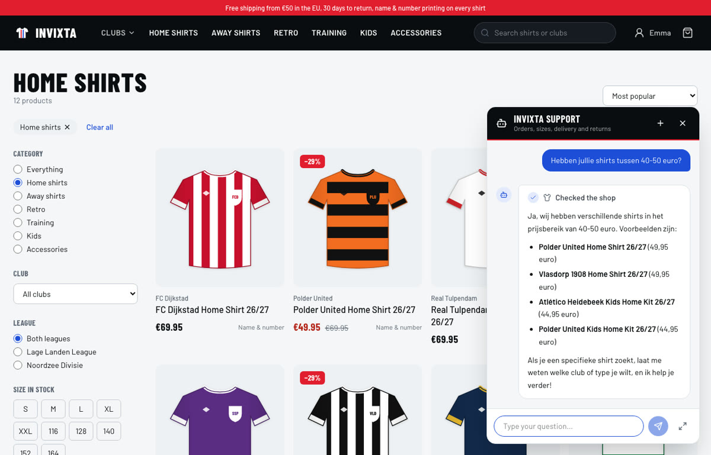
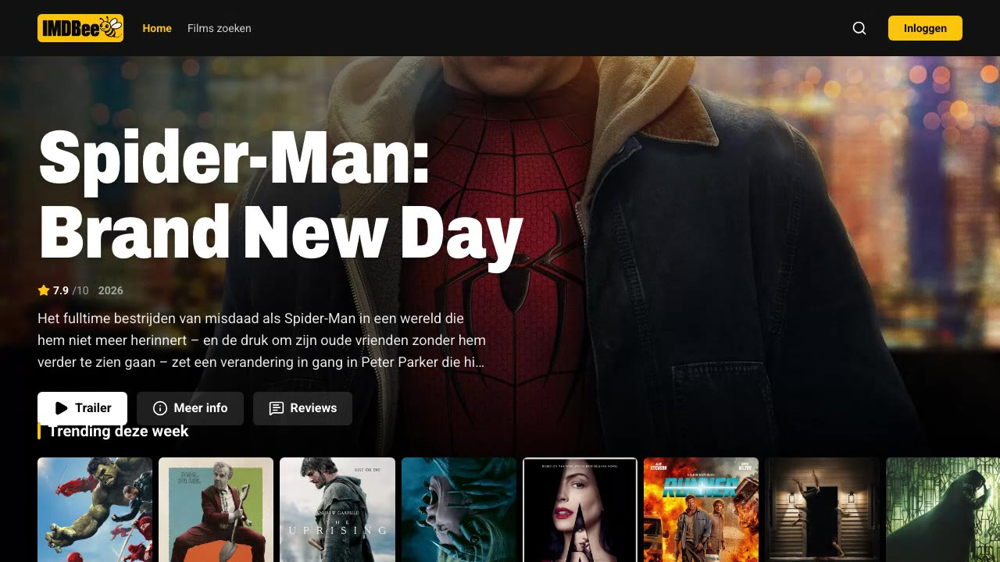
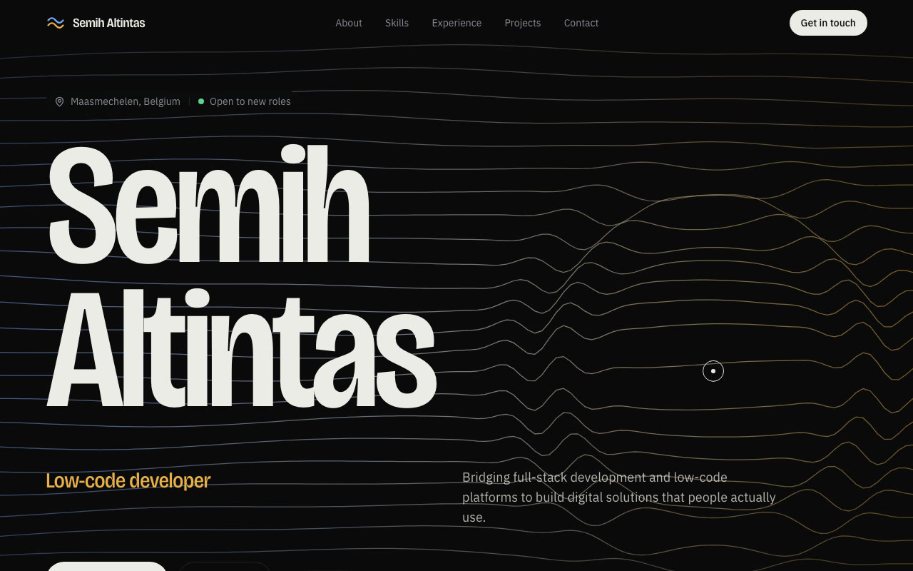

### Hi, I'm Semih

I'm an application developer from Belgium with a Bachelor in Applied Computer Science. I work where **full-stack development**, **low-code platforms** and **SAP Cloud** meet: some problems need hand-written Java or .NET, others are solved faster with a Power Automate flow or a CAP service on SAP BTP. I pick the right tool instead of the familiar one.

### Into AI

I'm an **AI enthusiast**. When I need to figure something out, I reach for AI first, and more and more for **AI agents** that look things up and take the next step on their own. In my free time I watch and read a lot about where AI is heading, and I experiment with it myself.

Want to see what that looks like? Have a look at the **[projects on my GitHub](https://github.com/InviXtaHydra?tab=repositories)**, starting with **[Invixta](https://github.com/InviXtaHydra/invixta)**: a web shop with an AI support agent that runs on a local model, searches the shop's documents with RAG and asks before it acts.

- Open to new roles as a full-stack, low-code or SAP BTP developer
- Latest project: **[Invixta](https://github.com/InviXtaHydra/invixta)**, a football-shirt web shop with a local AI support agent (FastAPI, PostgreSQL + pgvector, Ollama, React)
- Portfolio: **[semih-portfolio-zeta.vercel.app](https://semih-portfolio-zeta.vercel.app)**
- Used to Agile/Scrum teams: stand-ups, refinements, sprint reviews and code reviews
- Languages: Dutch and Turkish (native), English (fluent), French (basic)

## Tech stack

**Backend & languages** 

**Frontend & mobile** 

**Cloud, data & DevOps** 

**SAP cloud & integration** 

-0FAAFF?style=for-the-badge&logo=sap&logoColor=white)

**AI & agents** 
-000000?style=for-the-badge&logo=ollama&logoColor=white)

**Low-code & no-code** 

**Ways of working** 

## Featured projects

<table>
  <tr>
    <td width="50%" valign="top">
      
      <h3><a href="https://github.com/InviXtaHydra/invixta">Invixta</a></h3>
      
Football-shirt web shop with an AI support agent. It answers from real orders, stock and policy documents (RAG), runs on a local model in Ollama and asks the customer before it cancels anything.

      

        
        
        
        
      

      <a href="https://semih-portfolio-zeta.vercel.app/#projects"><b>Demo video</b></a> · <a href="https://github.com/InviXtaHydra/invixta"><b>Code</b></a>
    </td>
    <td width="50%" valign="top">
      
      <h3><a href="https://imdbee.vercel.app">IMDBee</a></h3>
      
Movie catalog with accounts, search and filters, star reviews and trailers. Live data from TMDB through a secured Spring Boot API.

      

        
        
        
        
      

      <a href="https://imdbee.vercel.app"><b>Live demo</b></a> · <a href="https://github.com/InviXtaHydra/imdbee"><b>Code</b></a>
    </td>
  </tr>
  <tr>
    <td width="50%" valign="top">
      
      <h3><a href="https://github.com/InviXtaHydra/semih-portfolio">Developer portfolio</a></h3>
      
My personal portfolio: a hero of wave lines that bend around your mouse (click to send a shockwave), skills, experience and projects with demo videos.

      

        
        
        
      

      <a href="https://semih-portfolio-zeta.vercel.app"><b>Live</b></a> · <a href="https://github.com/InviXtaHydra/semih-portfolio"><b>Code</b></a>
    </td>
    <td width="50%" valign="top"></td>
  </tr>
</table>

## Experience

| Period | Role | Company |
|---|---|---|
| Sep 2025 – Oct 2025 | Microsoft Power Platform Developer | Houben |
| Sep 2024 – May 2025 | Full-Stack & Low-Code Developer (internship) | Collide |

At **Houben** I built a SharePoint intranet with custom SPFx components and Power Automate workflows, and delivered a proof of concept within a tight timeline. At **Collide** I worked on an employee dashboard PWA: I wrote the first backend in Java and migrated it to Xano.

## Get in touch

